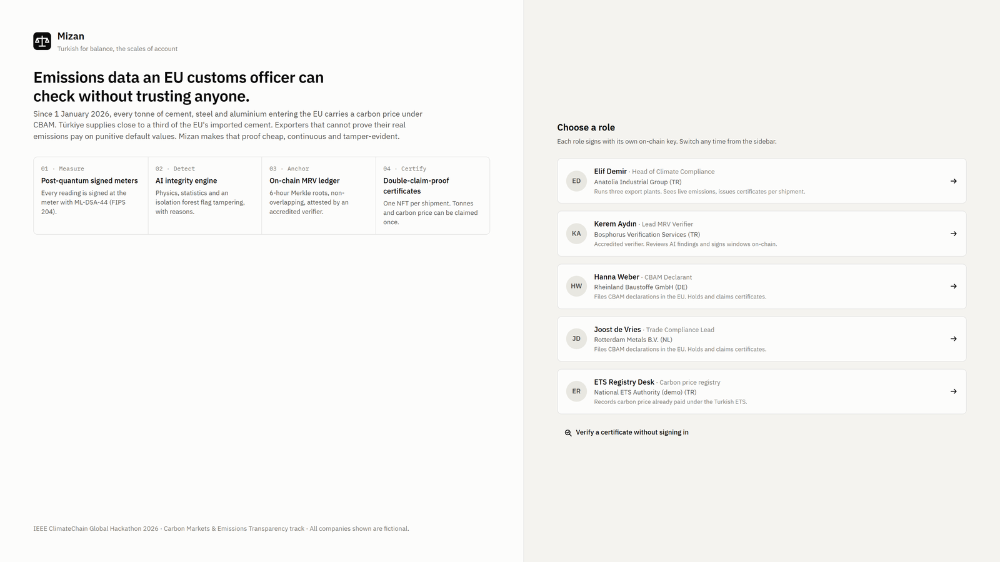
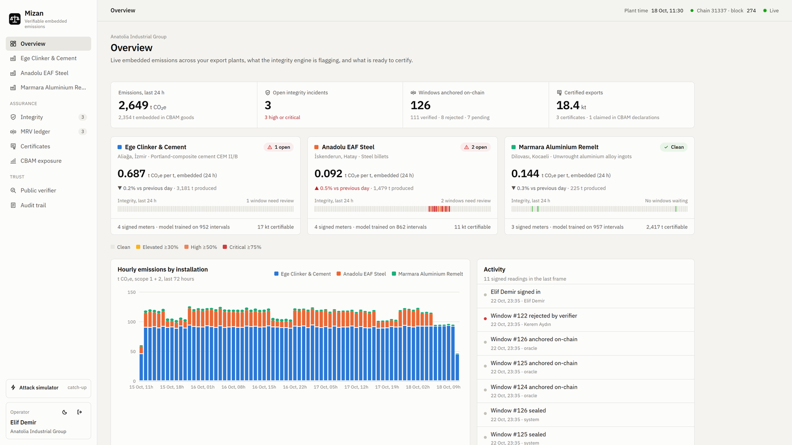
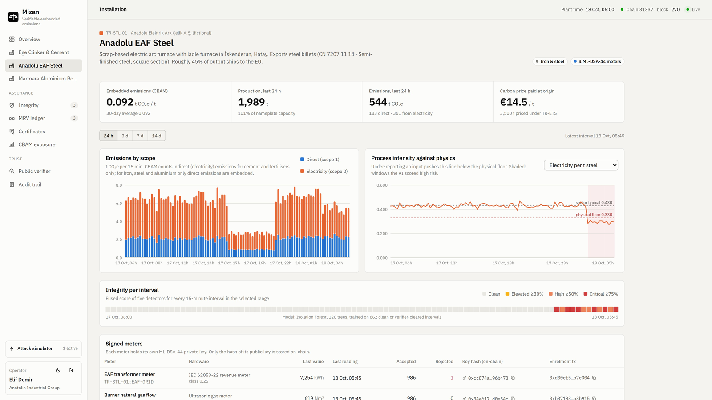
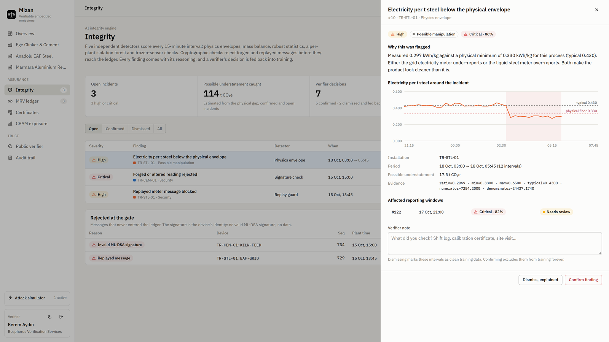
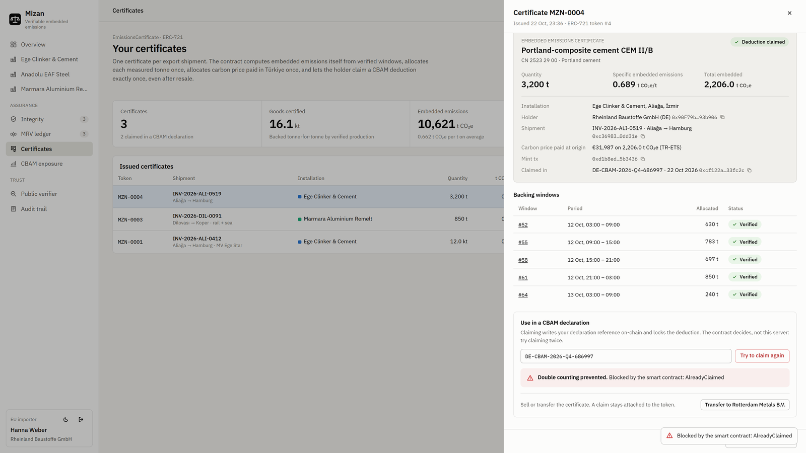
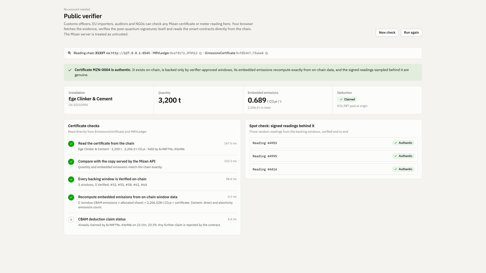
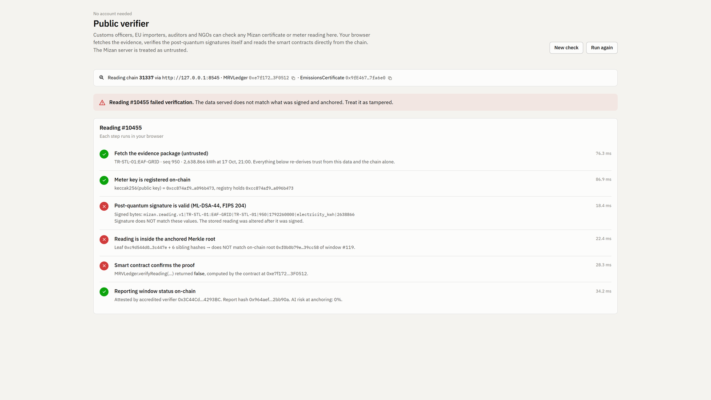
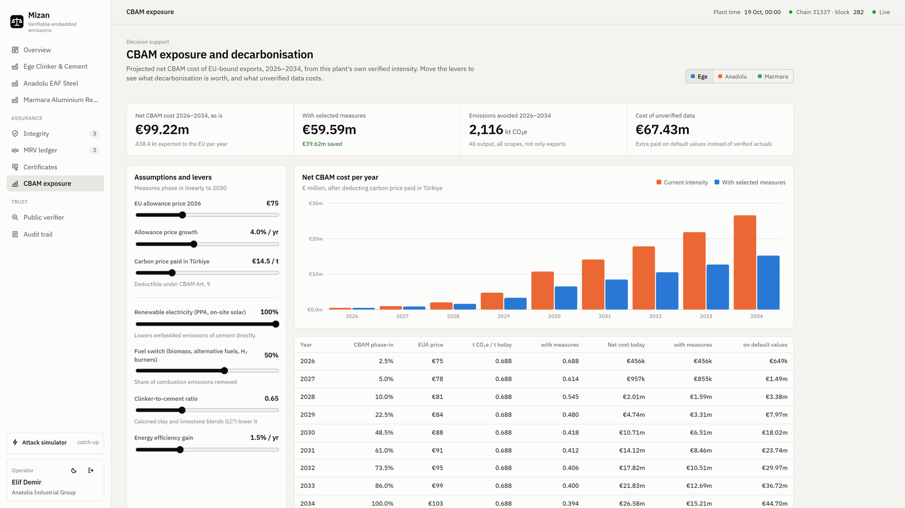
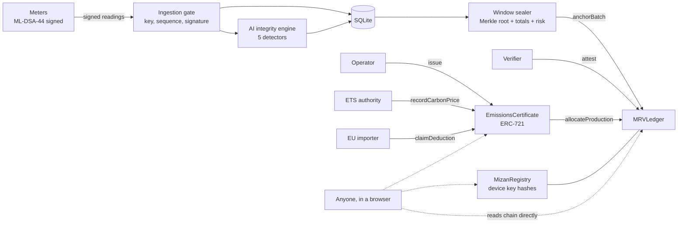

<p align="center">
  
</p>

<h1 align="center">Mizan</h1>

<p align="center"><strong>Balance, proven.</strong><br/>
Verifiable embedded-emissions accounting for exporters facing the EU Carbon Border Adjustment Mechanism (CBAM).</p>

<p align="center">
  <a href="https://github.com/opeblow/mizan/actions/workflows/ci.yml"></a>
  
  
  
  
  
  
  
</p>

<p align="center">
  <strong>Demo film (4:06):</strong> <em>YouTube link coming soon</em>
</p>

<p align="center">
  <a href="#quick-start">Quick start</a> ·
  <a href="docs/ARCHITECTURE.md">Architecture</a> ·
  <a href="docs/SECURITY_ASSESSMENT.md">Security assessment</a> ·
  <a href="docs/SETUP.md">Setup</a> ·
  <a href="CONTRIBUTING.md">Contributing</a> ·
  <a href="SECURITY.md">Report a vulnerability</a>
</p>

<p align="center">
  
  <br/>
  <sub>The landing page states the problem in one line, shows the four steps from meter to certificate, and lets each party in the CBAM value chain sign in with its own on-chain key.</sub>
</p>

---

Since 1 January 2026, every tonne of cement, steel and aluminium entering the EU carries a carbon price under CBAM. Türkiye supplies close to a third of the EU's imported cement and hosts COP31 this November. Exporters that cannot prove their real emissions are charged on default values with a mark-up, the proof behind most numbers is still a spreadsheet, and carbon already paid at home can be claimed twice.

Mizan (Turkish for *balance*, the scales of account) turns the meters inside a factory into evidence that anyone can verify and no one can quietly change:

1. **Measure.** Every meter signs each 15-minute reading with **ML-DSA-44**, the NIST post-quantum signature standard (FIPS 204).
2. **Detect.** An **AI integrity engine** scores every interval with five independent detectors and explains each finding in plain language. A human verifier decides, and that decision retrains the model.
3. **Anchor.** Readings are sealed every 6 hours into a **Merkle tree** and anchored **on-chain** with their emissions and risk score. An accredited verifier attests each window on-chain.
4. **Certify.** One **ERC-721 certificate per shipment**. The smart contract computes embedded emissions itself and lets every measured tonne, every euro of carbon price paid in Türkiye, and every CBAM deduction be used **exactly once**.
5. **Verify.** A **public verifier** checks signatures and proofs in the visitor's own browser, straight from the chain. The Mizan server is treated as untrusted.
6. **Plan.** A CBAM exposure planner projects 2026 to 2034 costs from verified data and prices decarbonisation levers.

---

## Screenshots

All screenshots are from the running product, not mock-ups.

<table>
  <tr>
    <td width="50%"><br/><b>Overview.</b> Live embedded emissions per tonne for three export plants, integrity risk per interval, windows anchored on-chain and certified exports.</td>
    <td width="50%"><br/><b>Tampering caught live.</b> A grid meter is altered to report 68% of real load. Electricity per tonne drops below the physical floor and the risk strip turns red within one interval.</td>
  </tr>
  <tr>
    <td width="50%"><br/><b>The AI explains.</b> Measured 0.297 kWh/kg against a physical minimum of 0.330, the two possible causes, and an estimate of the CO₂e that would have been hidden. The verifier confirms or dismisses.</td>
    <td width="50%"><br/><b>Double counting prevented.</b> The importer claims the deduction once; a second attempt is refused by the smart contract with <code>AlreadyClaimed</code>.</td>
  </tr>
  <tr>
    <td width="50%"><br/><b>Verify without trusting anyone.</b> The browser reads the certificate from the chain, recomputes its emissions and re-verifies post-quantum signatures of sampled readings.</td>
    <td width="50%"><br/><b>Insider edits fail.</b> A value changed directly in the database fails the signature, Merkle and on-chain proof checks.</td>
  </tr>
  <tr>
    <td colspan="2"><br/><b>Plan with verified data.</b> Net CBAM cost to 2034 as free allocation phases out, with renewable power, fuel switching, lower-clinker cement and efficiency levers, and the cost of falling back to default values.</td>
  </tr>
</table>

---

## Table of contents

- [Screenshots](#screenshots)
- [How Mizan meets every judging criterion](#how-mizan-meets-every-judging-criterion)
  - [Climate impact](#1-climate-impact)
  - [Innovation and creativity](#2-innovation-and-creativity)
  - [Technical execution](#3-technical-execution)
  - [Practical usefulness](#4-practical-usefulness)
  - [Presentation and storytelling](#5-presentation-and-storytelling)
  - [Organiser deliverables checklist](#organiser-deliverables-checklist)
- [Track alignment](#track-alignment)
- [Verified results](#verified-results)
- [Quick start](#quick-start)
- [A five-minute tour](#a-five-minute-tour)
- [Architecture](#architecture)
- [Smart contracts](#smart-contracts)
- [AI integrity engine](#ai-integrity-engine)
- [Security and data integrity](#security-and-data-integrity)
- [Project structure](#project-structure)
- [Tech stack](#tech-stack)
- [Documentation](#documentation)
- [Limitations, stated plainly](#limitations-stated-plainly)
- [Contributing](#contributing)
- [Security policy](#security-policy)
- [Citation](#citation)
- [License](#license)

---

## How Mizan meets every judging criterion

### 1. Climate impact
*Does the solution address a real climate challenge and improve transparency, carbon tracking or emissions reduction?*

| What judges look for | How Mizan delivers | Where to see it |
|---|---|---|
| A real, current climate problem | CBAM's definitive period started 1 Jan 2026; Türkiye's ETS rules were published 27 Aug 2026; Turkish exporters supply about 30% of EU cement imports | [docs/PLAN.md](docs/PLAN.md) |
| Emissions transparency | Every tonne of CO₂e traces back to signed meter readings anyone can verify | Public verifier: `apps/web/src/pages/Verify.tsx` |
| Catching under-reporting | Live attack test: a grid meter reporting 68% of real load was flagged within one interval, with an estimate of the CO₂e it would have hidden | `apps/api/src/integrity/engine.ts` |
| Driving actual reductions | Exposure planner prices renewable power, fuel switching, lower-clinker cement and efficiency in tonnes avoided and euros saved, 2026 to 2034 | `apps/web/src/pages/Exposure.tsx` |
| Making honesty cheaper than default values | The planner shows the cost of unverified data next to verified actuals | Same page |

### 2. Innovation and creativity
*Is the idea fresh, and does it take a unique approach to blockchain and emerging technologies?*

| Innovation | Why it is new |
|---|---|
| **Post-quantum signatures at the meter** (ML-DSA-44, FIPS 204) | CBAM evidence must hold up for years; signatures made today with ECDSA could be forged once large quantum computers exist. Mizan signs at the source with a lattice-based NIST standard and registers key hashes on-chain |
| **Double counting of carbon price paid at origin** | Carbon price paid in Türkiye is deductible from CBAM. Without a shared ledger the same paid tonne can be claimed by several EU importers. `EmissionsCertificate` allocates it once |
| **Contract-computed embedded emissions** | The certificate contract recomputes emissions from verified on-chain windows (applying the CBAM Annex II indirect-emissions rule per sector) instead of trusting a submitted number |
| **AI risk anchored on-chain and gating certification** | Each window's AI risk score is written on-chain; only verifier-approved windows can back a certificate |
| **Trustless verification in the browser** | A customs officer re-verifies signatures, Merkle paths and contract state without trusting the operator, Mizan or any API |

### 3. Technical execution
*Does it work, and is the technology well implemented and appropriate?*

| Evidence | Detail |
|---|---|
| Working end to end | `pnpm demo` starts a chain, deploys three contracts, runs the API, signs 10 days of meter history, runs every role's workflow and serves the web app |
| Tested | 13 Hardhat tests cover every on-chain guarantee; 6 unit tests cover ML-DSA, Merkle proofs, canonical encoding, emissions and CBAM maths; CI runs them on every push |
| Smart contracts | OpenZeppelin 5 AccessControl, ERC-721 and MerkleProof; custom errors; integer units; role separation |
| AI | Isolation forest written from scratch (deterministic, seeded), robust statistics, physics and mass-balance envelopes, noisy-OR fusion, human-in-the-loop retraining |
| Data platform | Fastify + SQLite ingestion gate, server-sent events, hash-chained audit log, integrity sweep comparing the database with on-chain roots |
| Standards | NIST FIPS 204, CBAM Regulation (EU) 2023/956 and Omnibus 2025/2083, IPCC 2006 factors, WBCSD-CSI cement protocol, ERC-721 |

### 4. Practical usefulness
*Could organisations, policymakers or businesses realistically use it?*

| User | Job done |
|---|---|
| Exporter (operator) | Continuous, verifier-ready evidence; one certificate per shipment; CBAM cost planning |
| Accredited verifier | Risk-ranked windows, explained anomalies, one-click attestation of clean data |
| EU importer | Certificates they can verify themselves; deduction claimed once, provably |
| National ETS authority | Carbon price records allocated once across all exports |
| Customs, NGOs, researchers | Free public verification |

Integration is one HTTP endpoint for signed readings; a six-week rollout plan, go-to-market through chambers of industry, and a scalability path to 1,000 plants are in [docs/ADOPTION.md](docs/ADOPTION.md).

### 5. Presentation and storytelling
| Item | Where |
|---|---|
| Demo film, 4:06, real product footage, original score | Link at the top of this page |
| Problem, solution and impact in one page | This README and [docs/PLAN.md](docs/PLAN.md) |
| Five-minute guided tour | [A five-minute tour](#a-five-minute-tour) |
| A UI designed to be understood | Colour-blind-safe validated palette, light and dark themes, every AI finding explained in words |

### Organiser deliverables checklist
The organisers' page lists these deliverables. All are in this repository.

| Required deliverable | Location |
|---|---|
| Working prototype (testnet deployment acceptable) | `pnpm demo`; testnet steps in [SETUP.md §5](docs/SETUP.md) |
| Source code with clear documentation | This repository |
| Architecture diagram and technical specification | [docs/ARCHITECTURE.md](docs/ARCHITECTURE.md) |
| Demo video | Link at the top of this page |
| Security and data integrity assessment | [docs/SECURITY_ASSESSMENT.md](docs/SECURITY_ASSESSMENT.md) |
| Problem statement and solution overview | This README |
| Implementation and adoption strategy | [docs/ADOPTION.md](docs/ADOPTION.md) |
| Scalability and sustainability roadmap | [docs/ADOPTION.md](docs/ADOPTION.md) |

---

## Track alignment

**Carbon Markets & Emissions Transparency.** The track asks for four builds; Mizan delivers all four.

| Track asks for | Mizan |
|---|---|
| Blockchain-based carbon credit verification | Per-shipment embedded-emissions certificates computed on-chain from verified windows |
| Real-time emissions tracking | Signed readings every 15 minutes, live dashboards and event stream |
| Smart contracts to prevent double counting | No overlapping windows; each measured tonne sold once; carbon price and CBAM deduction claimed once, even after resale |
| Transparent carbon trading platforms | Certificates are transferable tokens whose claim status travels with them; anyone can verify them |

---

## Verified results

All of these were observed on a full local run:

- 10,560 post-quantum-signed readings ingested from 11 meters on 3 plants; 120+ six-hour windows anchored on-chain.
- Live grid-meter tampering detected within one 15-minute interval: measured 0.297 kWh/kg against a physical floor of 0.330 for an electric arc furnace.
- Forged signature and replayed message rejected at the ingestion gate and raised as security incidents.
- A second CBAM deduction claim on the same certificate refused by the smart contract with `AlreadyClaimed`.
- An insider edit of one reading in the database failed public verification at the signature, Merkle and on-chain proof steps, and the integrity sweep located the broken window.
- ML-DSA-44 on a laptop: about 11 ms to sign and 3 ms to verify per reading.

---

## Quick start

Requirements: Node.js 22.13+ and pnpm 9+. No database, Docker or API keys.

```bash
git clone https://github.com/opeblow/mizan.git
cd mizan
pnpm install
pnpm demo
```

Open http://127.0.0.1:5173 and choose a role. `Ctrl+C` stops everything. On macOS or Linux, see [SETUP.md §1.3](docs/SETUP.md) first (one line to change).

| Command | What it does |
|---|---|
| `pnpm demo` | Chain, contracts, API, signed history, seeded workflows, live meters and web app |
| `pnpm --filter @mizan/contracts test` | Smart-contract tests |
| `pnpm --filter @mizan/shared test` | Crypto, Merkle and CBAM maths tests |
| `pnpm typecheck` | TypeScript across all packages |
| `pnpm tamper` | Plays an insider who edits a reading in the database |

---

## A five-minute tour

1. **Elif Demir, operator.** Overview, then *Anadolu EAF Steel*. Note the intensity line and its physical floor.
2. Sidebar, **Attack simulator**, *Tamper EAF grid meter*. A critical alert appears and the line drops below the floor.
3. Switch to **Kerem Aydın, verifier.** Integrity: open the incident and read why it was flagged. MRV ledger, *Needs review*: open the window and reject it on-chain.
4. **Elif.** Certificates: mint a certificate for a shipment.
5. **Hanna Weber, EU importer.** Open it, *Claim deduction*, then *Try to claim again*. The contract refuses.
6. **Public verifier**, no login: `/verify/certificate/1`. Every check runs in the browser against the chain.
7. Run `pnpm tamper`, then open the printed link. Verification fails. Audit trail, *Run full integrity sweep*.
8. **CBAM exposure**: move the levers.

---

## Architecture



Full specification: [docs/ARCHITECTURE.md](docs/ARCHITECTURE.md).

---

## Smart contracts

| Contract | Responsibility | Guarantees enforced on-chain |
|---|---|---|
| `MizanRegistry` | Installations and meter keys | Only registered post-quantum keys count; keys can be revoked; scheme id allows algorithm agility |
| `MRVLedger` | Six-hour MRV windows | Windows cannot overlap; one-time verifier attestation; `verifyReading` proves any reading is in an anchored window; production allocated at most once |
| `EmissionsCertificate` | Per-shipment ERC-721 | Emissions computed by the contract; no duplicate shipments; carbon price paid at origin allocated once; one CBAM deduction claim per certificate, kept through transfers |

## AI integrity engine

| Detector | Signal |
|---|---|
| Physics envelope | Energy, fuel or carbon per tonne outside what the process can physically do |
| Mass balance | An input reads zero while product keeps coming out |
| Robust statistics | A ratio far from the plant's own median (median absolute deviation) |
| Isolation forest | An unusual combination of readings, learned from the plant's own clean history |
| Frozen sensor | A meter repeating the exact same value while the plant produces |

Scores are fused with a noisy-OR into a risk per interval and per window. Every finding carries a plain-language explanation, its evidence, and an estimate of the CO₂e it could hide. Verifier decisions feed back into training.

## Security and data integrity

Post-quantum signatures at the source, replay and key-swap protection, Merkle commitments on-chain, role-separated contracts, a hash-chained audit log notarised in every window, and browser-side verification. The STRIDE analysis, smart-contract risk review and limitations are in [docs/SECURITY_ASSESSMENT.md](docs/SECURITY_ASSESSMENT.md).

---

## Project structure

```text
mizan/
├── .github/
│   ├── workflows/ci.yml            # Contract tests, crypto tests, typecheck, web build
│   ├── ISSUE_TEMPLATE/             # Bug report and feature request forms
│   ├── PULL_REQUEST_TEMPLATE.md
│   └── CODEOWNERS
├── apps/
│   ├── api/                        # Fastify + SQLite backend
│   │   └── src/
│   │       ├── server.ts           # REST routes, public verification API, live event stream
│   │       ├── ingest.ts           # Ingestion gate: device, sequence, timestamp, ML-DSA signature
│   │       ├── integrity/
│   │       │   ├── engine.ts       # Five detectors, explanations, incident merging
│   │       │   ├── iforest.ts      # Isolation forest (own implementation)
│   │       │   └── stats.ts        # Median, MAD, robust z, noisy-OR
│   │       ├── batcher.ts          # Window sealing, Merkle roots, on-chain anchoring
│   │       ├── services.ts         # Attestation, certificates, claims, integrity sweep
│   │       ├── queries.ts          # Dashboards and reading proofs
│   │       ├── chain.ts            # Wallets, transaction queue, revert decoding
│   │       ├── audit.ts            # Hash-chained audit log
│   │       ├── auth.ts             # Roles and sessions
│   │       ├── db.ts               # Schema
│   │       └── scripts/tamper.ts   # Insider-attack demonstration
│   ├── simulator/                  # Meter fleet holding ML-DSA private keys
│   │   └── src/
│   │       ├── main.ts             # Backfill, live mode, attack scenarios, control port
│   │       ├── plant.ts            # Cement, EAF steel and aluminium process models
│   │       ├── seed.ts             # Verifier, authority, operator and importer workflows
│   │       └── bench.ts            # ML-DSA-44 benchmark
│   └── web/                        # React + Vite web app
│       ├── public/mizan.svg        # Logo
│       └── src/
│           ├── pages/              # Login, Overview, Facility, Integrity, Ledger,
│           │                       # Certificates, Exposure, Verify, Audit
│           ├── components/         # App shell, charts, UI kit, attack console
│           └── lib/                # API client, chain reads, formatting
├── packages/
│   ├── contracts/                  # Solidity 0.8.24 + Hardhat
│   │   ├── contracts/
│   │   │   ├── MizanRegistry.sol
│   │   │   ├── MRVLedger.sol
│   │   │   └── EmissionsCertificate.sol
│   │   ├── scripts/deploy.ts
│   │   └── test/Mizan.test.ts
│   └── shared/                     # Used unchanged by meters, API and browser
│       └── src/
│           ├── reading.ts          # Canonical, domain-separated reading encoding
│           ├── pq.ts               # ML-DSA-44 sign and verify
│           ├── merkle.ts           # OpenZeppelin-compatible Merkle tree
│           ├── emissions.ts        # Emission factors, physics envelopes
│           ├── cbam.ts             # CBAM phase-in and exposure model
│           ├── catalog.ts          # Installations and meters
│           └── core.test.ts
├── docs/
│   ├── ARCHITECTURE.md             # Architecture and technical specification
│   ├── SECURITY_ASSESSMENT.md      # Security and data integrity assessment
│   ├── ADOPTION.md                 # Adoption strategy and scalability roadmap
│   ├── SETUP.md                    # Setup, testing, testnet deployment
│   ├── PLAN.md                     # Strategy and judging map
│   └── images/                     # README screenshots
├── scripts/demo.mjs                # One-command demo orchestrator
├── AGENTS.md                       # Guide for coding agents
├── CHANGELOG.md
├── CODE_OF_CONDUCT.md
├── CONTRIBUTING.md
├── SECURITY.md                     # Vulnerability disclosure policy
├── LICENSE
└── README.md
```

---

## Tech stack

| Layer | Technology |
|---|---|
| Smart contracts | Solidity 0.8.24, OpenZeppelin Contracts 5, Hardhat 2.22, ethers 6 |
| Post-quantum cryptography | ML-DSA-44 (NIST FIPS 204) via `@noble/post-quantum` |
| Backend | Node.js 22+, Fastify 5, built-in `node:sqlite`, zod |
| AI | Isolation forest, robust statistics and physics envelopes in TypeScript |
| Frontend | React 18, Vite 5, React Router, hand-built SVG charts, IBM Plex |
| Tooling | pnpm workspaces, TypeScript strict, GitHub Actions |

## Documentation

| Document | Contents |
|---|---|
| [docs/SETUP.md](docs/SETUP.md) | Install, run, test, deploy to Polygon Amoy, troubleshoot |
| [docs/PLAN.md](docs/PLAN.md) | Research, judging map, timeline, submission checklist |
| [docs/ARCHITECTURE.md](docs/ARCHITECTURE.md) | System diagram, data flow, contracts, API, detectors, standards |
| [docs/SECURITY_ASSESSMENT.md](docs/SECURITY_ASSESSMENT.md) | Security and data integrity assessment: threat model, STRIDE, contract risks |
| [docs/ADOPTION.md](docs/ADOPTION.md) | Users, rollout, go-to-market, scalability, roadmap |
| [AGENTS.md](AGENTS.md) | Code layout, commands and invariants |
| [CONTRIBUTING.md](CONTRIBUTING.md) | How to propose changes, quality bar, protocol invariants |
| [SECURITY.md](SECURITY.md) | Vulnerability disclosure policy |
| [CHANGELOG.md](CHANGELOG.md) | Release history |

## Limitations, stated plainly

- Meters are simulated, using published sector intensities; real deployments connect existing meters through a signing gateway.
- The chain layer uses ECDSA accounts, so the system is post-quantum at the data source, not end to end. The migration path is in [docs/SECURITY_ASSESSMENT.md](docs/SECURITY_ASSESSMENT.md).
- The local demo holds every role's key on the server for one-command convenience; in production each party signs with its own wallet.
- The CBAM cost model is simplified and its default values are illustrative.
- All companies shown are fictional.

## Contributing

Contributions are welcome. Read [CONTRIBUTING.md](CONTRIBUTING.md) for the workflow, the quality bar and the protocol invariants every change must preserve. Everyone taking part is expected to follow the [Code of Conduct](CODE_OF_CONDUCT.md).

## Security policy

Please report vulnerabilities privately as described in [SECURITY.md](SECURITY.md). Do not open public issues for security problems.

## Citation

If you refer to Mizan in research or reports:

```bibtex
@software{mizan2026,
  title  = {Mizan: Verifiable Embedded-Emissions Accounting for CBAM with Post-Quantum Signed Meters and On-Chain MRV},
  author = {opeblow and Mizan contributors},
  year   = {2026},
  url    = {https://github.com/opeblow/mizan},
  note   = {IEEE ClimateChain Global Hackathon 2026, Carbon Markets and Emissions Transparency track}
}
```

## License

Released under the [MIT License](LICENSE).
