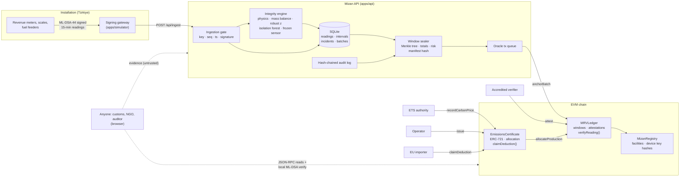

# Architecture and technical specification

## 1. System overview

## 2. Data flow, one reading to one CBAM deduction

1. **Measure.** A meter produces an integer reading for a 15-minute interval and signs `mizan.reading.v1|device|facility|seq|ts|metric|valueMilli` with its ML-DSA-44 key.
2. **Gate.** The API checks enrolment, status, facility/metric binding, monotonic sequence and timestamp, and the signature. Accepted readings get `payloadHash = sha256(canonical)`, `signatureHash = sha256(signature)` and `leaf = keccak256(keccak256(payloadHash ‖ signatureHash))`.
3. **Interval.** When every meter of the plant has reported for a timestamp, emissions are computed (direct: fuels, charge carbon, calcination; indirect: grid electricity) and the integrity engine scores the interval.
4. **Seal.** When the first interval of a new 6-hour window completes, the previous window is sealed: Merkle root, metric totals, emissions, production, completeness, fused risk, incidents, current audit-log head. `evidenceHash = sha256(manifest)`.
5. **Anchor.** The oracle calls `MRVLedger.anchorBatch` (period must not overlap the previous one).
6. **Attest.** The verifier reviews incidents, then calls `attest(batchId, approved, sha256(report))`.
7. **Certify.** For a shipment, the operator asks the API to plan allocations (oldest verified production first). `EmissionsCertificate.issue` re-reads each window, allocates production via `MRVLedger.allocateProduction`, computes embedded emissions on-chain, allocates carbon price paid at origin and mints an ERC-721 to the importer.
8. **Claim.** The importer calls `claimDeduction(tokenId, keccak256(declarationRef))` once.
9. **Verify.** Anyone recomputes and checks every step from the browser.

## 3. Smart contracts (`packages/contracts`)

| Contract | Key state | Key functions | Guarantees |
|---|---|---|---|
| `MizanRegistry` | facilities (operator, country, CBAM sector, name), devices (facility, pubKeyHash, scheme, active) | `registerFacility`, `registerDevice`, `revokeDevice`, `getDevice` | Only registered keys count; scheme id allows PQ algorithm agility |
| `MRVLedger` | batches (period, root, totals, production, allocated, risk, status, attestation), `lastPeriodEnd` per facility | `anchorBatch`, `attest`, `allocateProduction`, `verifyReading`, `leafOf` | No overlap; one-time attestation; allocation ≤ production; on-chain inclusion proofs |
| `EmissionsCertificate` | certificates, allocations, carbon price accounts, shipment index | `recordCarbonPrice`, `issue`, `claimDeduction`, `getCertificate`, `getAllocations` | On-chain emissions arithmetic; no duplicate shipment; carbon price allocated once; one claim per token for ever |

Roles: `REGISTRAR_ROLE`, `ORACLE_ROLE`, `VERIFIER_ROLE`, `CERTIFIER_ROLE` (held by the certificate contract), `ISSUER_ROLE`, `AUTHORITY_ROLE`, `DEFAULT_ADMIN_ROLE`.

Units: kilograms and euro cents as integers. Risk in basis points.

## 4. API (`apps/api`)

Fastify 5, Node 22+ built-in `node:sqlite`, ethers 6, zod. Endpoints:

| Area | Endpoints |
|---|---|
| Machines | `POST /api/devices/enroll` (enrolment token), `POST /api/ingest` (signatures are the auth) |
| Session | `GET /api/auth/users`, `POST /api/auth/login`, `GET /api/auth/me` |
| Dashboards | `GET /api/overview`, `/api/facilities[/:id]`, `/api/facilities/:id/series`, `/ratios`, `/allocations` |
| Integrity | `GET /api/incidents[/:id]`, `POST /api/incidents/:id/review` (verifier), `GET /api/rejections` |
| Ledger | `GET /api/batches[/:id]`, `POST /api/batches/:id/attest` (verifier), `POST /api/batches/attest-low-risk` |
| Certificates | `GET/POST /api/certificates`, `POST /api/certificates/:id/claim` and `/transfer` (importer), `GET /api/importers` |
| Carbon price | `GET/POST /api/carbon-prices` (authority) |
| Trust | `GET /api/audit`, `GET /api/integrity/sweep` |
| Public | `GET /api/public/config`, `/api/public/readings[/:id]`, `/api/public/certificates/:id`, `/api/public/batches/:id` |
| Live | `GET /api/stream` (Server-Sent Events, coalesced) |
| Demo | `POST /api/demo/scenario`, `GET /api/demo/status` |

## 5. Integrity engine (`apps/api/src/integrity`)

| Detector | Signal | Score |
|---|---|---|
| `missing` | Input reads 0 while output > 15% of median | 0.90 |
| `physics` | Ratio (e.g. kWh per kg steel) outside the process envelope | 0.62 + 1.4 × relative distance, ≤ 0.97 |
| `statistical` | \|robust z\| > 4.5 vs. plant median/MAD of clean history | 0.42 + (\|z\| − 4.5)/12, ≤ 0.85 |
| `iforest` | Isolation Forest score > 0.60 over [normalised ratios, production rate, hour sin/cos] | 0.35 + 2.2 × (s − 0.60), ≤ 0.80 |
| `stuck` | Four identical consecutive values while producing | 0.60 |

Interval risk = 1 − Π(1 − scoreᵢ). Window risk = noisy-OR of max interval risk, rejected-message score and data-gap score. Isolation forest: 120 trees, ψ = 256, height limit ⌈log₂ ψ⌉, seeded per plant, retrained every 96 intervals and after each verifier decision.

## 6. Web (`apps/web`)

React 18, Vite 5, React Router 6, ethers 6 (browser reads), `@mizan/shared` (same hashing, Merkle and ML-DSA code as the server). Hand-built SVG charts; validated colour-blind-safe categorical palette; light and dark themes; IBM Plex Sans/Mono. Live updates via one shared EventSource.

## 7. Shared library (`packages/shared`)

Canonical reading encoding, sha256/keccak, OpenZeppelin-compatible Merkle tree, ML-DSA-44 wrappers, facility catalogue, emission factors, CBAM phase-in and exposure model. Used unchanged by meters, API and browser so all three compute identical hashes.

## 8. Standards used

| Standard | Use |
|---|---|
| NIST FIPS 204 (ML-DSA) | Meter signatures |
| Regulation (EU) 2023/956 (CBAM), Annex I and II; Omnibus Regulation (EU) 2025/2083 | Sectors, CN codes, indirect-emission rule, phase-in |
| EU ETS Directive 2003/87/EC Art. 10a(1a) | Free-allocation phase-out schedule |
| IPCC 2006 Guidelines | Fuel emission factors |
| WBCSD-CSI Cement CO₂ Protocol | Clinker calcination factor |
| ERC-721, OpenZeppelin AccessControl and MerkleProof | Certificates, roles, proofs |
| IEC 62053-22, OIML R76 | Meter and scale classes in the device catalogue |
